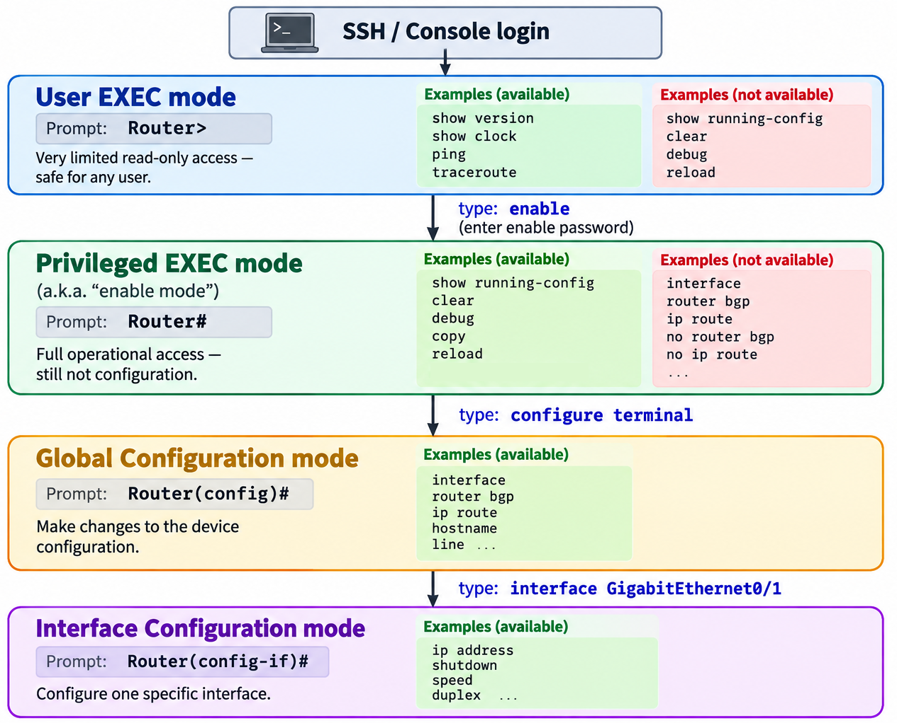

# Lab-cli

Lab-CLI is a Klish-based command environment designed for hands-on experimentation, demos, and controlled system operations in the lab. Instead of running arbitrary Linux commands, Lab-CLI exposes a safe, curated set of workflows - things like viewing system information, changing basic settings, and triggering lab utilities - all through a structured, network-device-style interface.

Because Lab-CLI runs on top of Klish 3’s client-server architecture, it cleanly separates command parsing from execution logic. That makes it suitable for multi-user environments, containerized setups, and scenarios where command auditing and safety matter. Scripts live in one place, configuration lives in another, and the CLI becomes a stable interface layered on top.

Refer to the following guides for more details:

- [Klish Introduction](docs/README_KLISH.md)
- [CLI in SONiC Ecosystem](docs/README_CLI_SONIC.md)
- [Smart Command Suggestions](docs/README_SUGGESTIONS.md)

## Project Structure

The project is self-contained inside a container, giving you an isolated, reproducible setup. All CLI definitions, scripts, and configuration files live under the `klish/` directory and are bundled into the image at build time.

    ├─ docker-compose.yml
    ├─ Dockerfile
    └─ klish/
        ├─ xml/
        │  └─ main.xml
        ├─ scripts/
        │  └─ ...
        ├─ patches/
        │  └─ klish-suggest.patch  # smart command suggestions
        ├─ config/
        │  ├─ klishd.conf          # server config
        │  └─ klish.conf           # client config
        └─ entrypoint.sh

## Getting Started

Build the container:

    docker compose build

Start the container in background:

    docker compose up -d

Check the logs to verify that everything started correctly:

    docker logs netlab-cli

Open an interactive shell to the container:

    docker exec -it netlab-cli bash

Start the Klish interactive CLI:

    klish

Sample output:

    NetLab> show greeting
    Hello from NetLab-CLI!
    This is a Klish (clish) demo running in Docker.
    NetLab> exit

Or run a command using the `-c` option:

    klish -c "show greeting"

## Klish Terminal Sessions

Klish 2 operates as a single monolithic binary (`clish`) and handles parsing, execution, and user interaction simultaneously. Klish 3, on the other hand, adopts a Client-Server architecture. This decoupling significantly improves stability, concurrency, and performance.

- `klishd`: A background daemon that loads XML configuration files, maintains the internal database, and listens for incoming connections.

- `klish`: A lightweight "dumb terminal" client. It connects to the daemon (typically via a Unix Socket) to transmit keystrokes and display output.

When a client connects, the daemon creates a unique environment for that specific interaction. The klish client connects to the master klishd process. Upon accepting the connection, the master klishd forks a new child process dedicated exclusively to that connection. This child process represents the Session. This new model provides the following characteristics:

- **Isolation**: Every connected user is assigned a dedicated process with a unique Process ID (PID).

- **Memory Separation**: Because sessions run as separate processes, they do not share memory space. User A cannot access or modify User B's variables. This ensures high stability. A crash in one session will not affect the main daemon or other users.

- **Lifetime**: A session persists only as long as the client remains connected. Terminating the client (e.g., typing `exit` or closing the terminal) causes the corresponding klishd child process to terminate.

To verify this architecture, we can open multiple interactive terminals to the container and inspect the process hierarchy. By running `show terminal session` in two separate terminals, we can observe unique PIDs for each user, confirming they are separate entities.

First client:

    NetLab> show terminal session

    --- Session Information ---
    Session PID: 22
    User ID:     0
    User Name:   root
    Command:     session

Second client:

    NetLab> show terminal session

    --- Session Information ---
    Session PID: 43
    User ID:     0
    User Name:   root
    Command:     session

Inspecting the system processes confirms the relationship between the Master Daemon, the Session Workers, and the Clients. PID 7 is the Master Server. It loaded the XMLs once at startup. It does not execute commands itself; it only listens for new connections.

    # ps -ef | grep klish
    root           7       1  0 02:02 pts/0    00:00:00 klishd -f /etc/klish/klishd.conf -d -v
    root          23       7  0 02:02 pts/0    00:00:00 klishd -f /etc/klish/klishd.conf -d -v
    root          22      10  0 02:02 pts/1    00:00:00 klish
    root          44       7  0 02:03 pts/0    00:00:00 klishd -f /etc/klish/klishd.conf -d -v
    root          43      31  0 02:03 pts/2    00:00:00 klish

Session A (PID 23):

- Parent: PID 7 (The Master).
- Role: A dedicated worker process created to handle Client A (PID 22).
- Stability: If this session crashes, the Master (PID 7) and Session B (PID 44) remain unaffected.

Session B (PID 44):

- Parent: PID 7 (The Master).
- Role: A dedicated worker process created to handle Client B (PID 43).
- Isolation: Totally independent from Session A.

## CLI Features

### Tab Completion (Static)

Klish provides context-aware Tab completion. As you type a command, it analyzes where you are in the syntax tree and suggests only the tokens that are valid at that position. When you type:

    NetLab> show <TAB>

Klish looks at all child elements defined under the `show` command in the XML and shows the available subcommands:

    NetLab> show
    greeting    interface    ip   terminal   version

### Tab Completion (Dynamic)

Klish can also perform dynamic (runtime-generated) Tab completion. Instead of listing static keywords, it can run a script or program to discover valid values. For example, after defining a parameter whose type pulls interface names from `/sys/class/net`, pressing Tab after show interface produces:

    NetLab> show interface <TAB>
    eth0   lo

Here, Klish:

- Detects that you are completing the `iface` parameter.
- Calls the completion script associated with its parameter type.
- Displays each returned value as a completion candidate.

### Inline Help

Klish provides inline help. When you use `?`, it shows both the command keyword and a short description:

    NetLab> show ?
    greeting   Display a welcome message
    interface  Show interface details
    ip         Show IP-related information
    terminal   Display terminal information
    version    Show system version

The left column comes from each command’s `name` attribute, and the right column comes from its `help` attribute. This makes the CLI self-documenting. The user does not need to remember every command.

### Command Abbreviation

Klish 3 uses a strict command resolver by default. In this mode, users must either type the full command name or rely on tab completion to expand it. Typing a partial keyword that does not exactly match a command results in an error, even if the prefix is unique:

    NetLab> his
    Error: Illegal command

Command abbreviations can be enabled explicitly by using the `value` attribute with the `|` delimiter:

    <COMMAND name="history" value="his|tory" />

The portion before `|` (`his`) is the mandatory prefix and the portion after `|` (`tory`) is an optional suffix. The user must type at least the mandatory prefix. Any progressive extension of the optional suffix is accepted. For the example above, the following inputs are valid:

```text
his
hist
histo
histor
history
```

Command abbreviations can be useful when commands are long and operators are already familiar with the CLI syntax, as they reduce typing effort and improve efficiency for experienced users. However, abbreviations can also introduce ambiguity (especially as the command set grows or evolves) which may lead to unexpected command resolution or operator error. For this reason, their use should be deliberate and carefully controlled, and they are often discouraged in favor of explicit commands and reliable tab completion.

### Default Sub-commands

A default sub-command means a parent command has exactly one child, and the CLI automatically runs that child if the user stops early. Conceptually:

    show ip           ⇒ would automatically run the only child
    show ip interface ⇒ runs it explicitly

In Klish 3, this behavior is not automatic. The parent (`ip`) is considered incomplete unless you define an explicit `<ACTION>` for it. If you want `show ip` to execute the same logic as `show ip interface`, you must configure that intentionally in the XML.

### Parameter Validation

In Klish 2, parameter validation was often handled directly within the XML definition using the `pattern` attribute, which accepted a regular expression. The CLI engine itself would check the user's input against this regex before allowing the command to proceed. This provided a simple, declarative way to enforce formats like IP addresses or ranges without writing external code.

In Klish 3, this built-in regex engine has been removed in favor of a more flexible, plugin-based architecture. Validation is now delegated entirely to Symbols (functions) inside plugins. To validate a parameter, you define a `PTYPE` (Parameter Type) that contains an `<ACTION>`. When a user enters a value, Klish passes that value to the action (typically a script or a C function). The action must process the input and return an exit code: 0 for valid and non-zero for invalid. This approach, while slightly more verbose in XML, allows for arbitrarily complex validation logic beyond what simple regular expressions could achieve.

    NetLab> ping 8.8.8.256
    Error: Illegal command

### Command History

Command history refers to the ability to recall previously executed commands, typically accessed via arrow keys (for immediate reuse) or a `history` command (for a full list). In a standard shell environment like Bash, this is straightforward. A single shell process remains active for the entire session, holding all past inputs in its memory.

The standard `history` command fails in Klish 3 due to ephemeral execution environments. When the Klish server receives a command from the client, it spawns a brand new, isolated shell process solely to execute that specific action. This temporary shell is born with a "blank mind". It has no knowledge of previous commands and terminates immediately after its task is done. Therefore, if you create a Klish command that simply invokes `history`, it triggers a fresh shell that has essentially never run anything before, resulting in empty output.

The solution is to manually implement persistence using `<LOG>`. Since the Klish server has access to the command string currently being executed (exposed via the `KLISH_PARENT_LINE` environment variable), you can configure a global `<LOG>` tag to intercept every command and append it to a persistent text file. The `history` command is then redefined not to ask the shell for its memory, but to read and display the contents of this log file.

    NetLab> history
      1  show ip interface
      2  history
      3  show interface eth0

Note that this history is global, not per-session. Different CLI sessions all append to the same log file, so every user sees a unified record of commands that have been executed in the lab. This has clear benefits. It behaves like an audit trail, survives reconnects, and makes it easy to review what was tried previously. The trade-off is that it does not behave like a personal shell history. Commands from different users and sessions are mixed together, and history reflects system activity rather than just the current session.

### Text Filters

The Klish 3 engine provides native support for piping command output through text filters using the `|` operator. Any `<COMMAND>` element with the attribute `filter="true"` is automatically available as a pipe target, allowing users to refine output without additional plumbing.

    NetLab> show interface eth0 | grep inet
        inet 172.18.0.2/16 brd 172.18.255.255 scope global eth0

The following utilities are available:

| Utility     | Description                                         |
| ----------- | --------------------------------------------------- |
| **head**    | Keep only the first N lines of output.              |
| **tail**    | Keep only the last N lines of output.               |
| **include** | Show only lines that contain the given text.        |
| **exclude** | Hide lines that contain the given text.             |
| **begin**   | Start output from the first line matching a pattern.|
| **grep**    | Search output for lines matching a text (or regex). |
| **count**   | Count the number of lines in the output.            |

> **`include` vs `grep`:** Both match lines by pattern, but `include` is case-insensitive (`grep -Ei`) while `grep` is case-sensitive (`grep -E`). Use `include` for quick, forgiving searches and `grep` when exact casing matters.

### Formatters

Formatters transform command output into a structured data format such as JSON, XML, or CSV. Unlike text filters that work on raw text line-by-line, a formatter requires the upstream command to produce structured data so the output is semantically meaningful.

| Formatter | Description                                      |
| --------- | ------------------------------------------------ |
| **json**  | Emit output as a JSON document.                  |
| **xml**   | Emit output as an XML document.                  |
| **csv**   | Emit output as comma-separated values.           |

In Klish 3, the `|` character is reserved by the engine for text filters. Formatters therefore use the `format` keyword instead. The `format` parameter is implemented as an optional subcommand inside each `show` command. When present, the command switches to a structured data source (for example, `ip -j addr show` instead of `ip addr show`) and pipes the result through a format converter

Json Example:

    NetLab> show interface eth0 format json

    [
      {
        "ifindex": 3,
        "ifname": "eth0",
        "flags": ["BROADCAST", "MULTICAST", "UP", "LOWER_UP"],
        "mtu": 1500,
        ...
      }
    ]

CSV Example:

    NetLab> show version format csv

    "system","node","release","version","machine"
    "Linux","abcd1234","6.6.87","#1 SMP ...","x86_64"

XML Example:

    NetLab> show ip interface format xml

    <output>
      <item>
        <ifname>lo</ifname>
        <operstate>UNKNOWN</operstate>
        ...
      </item>
      <item>
        <ifname>eth0</ifname>
        ...
      </item>
    </output>

Formatted output can still be piped through text filters. The formatter runs first (inside the command), and the text filter operates on the formatted result via the normal pipe:

    NetLab> show interface eth0 format json | grep ifname
        "ifname": "eth0",

> Piping a text filter after a formatter will return matching lines but may produce an incomplete document.

### External Scripts

While Klish allows you to write small logic blocks directly inside the XML, complex operations are best handled by invoking external Bash or Python scripts. This approach treats the CLI as a "frontend" while offloading the heavy lifting to specialized backend scripts.

The script plugin in Klish spawns a standard shell instance. To invoke an external script, you simply provide the full path to the executable file within the `<ACTION>` tag. You can pass Klish parameters to these scripts either as command-line arguments or by reading the environment variables Klish automatically exports.

The following example demonstrates the `sys-check` command. This command illustrates how Klish captures user input (a parameter) and passes it directly to an underlying Bash script to control execution logic. In this scenario, the user selects the `cpu` target. Klish passes this argument to the script, which then filters the system information accordingly.

    NetLab# sys-check cpu
    --------------------------------
    Checking System: cpu
    --------------------------------
    22:09:21 up 4 days, 13:25,  0 user,  load average: 0.50, 0.49, 0.37
    Processors: 36
    --------------------------------

### Lua

Klish includes Lua as a built-in scripting engine. In Klish 3, the Lua plugin is part of the core architecture and is the preferred way to add logic that needs to be closely integrated with the CLI itself such as context handling, prompts, validation, and session-aware behavior.

Lua is not a replacement for Bash or Python. Instead, it fills a gap those languages cannot easily solve inside a CLI engine. Lua executes inside the Klish process (not as an external program), which allows it to:

- Access CLI context and parameters directly
- Maintain session state without temporary files
- Build dynamic prompts and modes
- Run lightweight control logic without creating new processes

### Views

A **view** in Klish is a logical container that groups related commands together. Think of it as a separate "room" inside the CLI — when you enter a view, you see only the commands that belong to that room.

For example, navigating from the main menu into the `tools` view changes the prompt and shows only the commands available there:

    NetLab> tools
    NetLab(tools)#
      date       Show current date
      sys-check  Check system resources
      exit       Go back

Views provide four key benefits:

1. **Organization** — Instead of presenting every possible command at once, views group them into manageable categories. You only see what is relevant to your current task.

2. **Safety** — Sensitive commands (like `reboot` or `format`) are only accessible inside specific views, reducing the risk of running something dangerous by accident.

3. **Workflow guidance** — When you enter a view for a specific object (for example, a network interface), every command you type automatically applies to that object. You do not need to repeat the object name with every command.

4. **Name reuse** — The same command name can exist in different views without conflict. For example, `restart` could restart a single service inside a Service View, but restart the entire system inside a System View.

This pattern is not unique to Klish. Nearly every managed network device uses the same idea. The next section walks through the industry-standard Cisco IOS hierarchy, so you can see where this design comes from.

### Industry-Standard CLI Model

Cisco IOS introduced the modal CLI that most network vendors follow today. The hierarchy has four levels, each entered by typing a specific command and exited with `exit`. The prompt always to show which level you are in.

#### The Cisco IOS Mode Hierarchy



The sections below explain each level step by step: what it is for, how you get into it, and what you can (and cannot) do once inside.

#### Step 1 — User EXEC Mode

**Prompt:** `Router>`

This is the first level every user sees after logging in via SSH or console. It provides only basic, read-only commands — `ping`, `traceroute`, `show clock` — and nothing that can modify the device. Think of it as the lobby of a building: you can look around, but you cannot open any doors.

The name *EXEC* refers to the command-execution environment (as opposed to configuration). The *User* qualifier distinguishes this restricted level from the more powerful Privileged EXEC level.

#### Step 2 — Privileged EXEC Mode (Enable Mode)

**Prompt:** `Router#`

To reach this level, type `enable` and enter the enable password. The session escalates from the `>` prompt to the `#` prompt.

Privileged EXEC unlocks full operational access: every `show` command (including `show running-config`), diagnostic tools (`debug`, `clear`), and system operations (`copy`, `reload`). However, it does **not** allow configuration changes — you cannot modify interfaces, routing protocols, or any part of the running config. To make changes, you must go one level deeper.

#### Step 3 — Global Configuration Mode

**Prompt:** `Router(config)#`

Enter this level by typing `configure terminal` (often abbreviated `conf t`) from Privileged EXEC. Commands here apply to the device as a whole — setting the hostname, adding static routes, or entering a sub-configuration mode for a specific component.

The separation between Privileged EXEC and Global Configuration exists so that operators who only need to monitor and troubleshoot cannot accidentally change the device's configuration.

#### Step 4 — Interface Configuration Mode (and Other Sub-Modes)

**Prompt:** `Router(config-if)#`

From Global Configuration, type an interface name — for example, `interface GigabitEthernet0/1` — to enter a sub-configuration mode scoped to that single interface. Every command you type (`ip address`, `shutdown`, `speed`, `duplex`) applies only to that interface.

The same pattern extends to other sub-modes: `(config-router)` for routing protocols, `(config-line)` for console and VTY lines, and so on.

#### Mode Summary

| Mode            | Prompt      | Read config? | Clear / reload? | Change config? |
|-----------------|-------------|:------------:|:---------------:|:--------------:|
| User EXEC       | `>`         | Limited      | ✗               | ✗             |
| Privileged EXEC | `#`         | Full         | ✓               | ✗             |
| Global Config   | `(config)#` | Full         | ✓               | ✓             |

The three-tier model separates **observation** (User EXEC) from **operation** (Privileged EXEC) from **configuration** (Global Config). Each deeper level narrows the scope of available commands, and the prompt always reflects the current context.

#### The Access-Control Problem

The view/mode hierarchy controls *which commands are available where*, but it does not control *who is allowed to run them*. These are two separate concerns:

| Concept            | What it controls                                     |
|--------------------|------------------------------------------------------|
| **View / Mode**    | Which commands are *available* at the current prompt |
| **Access control** | Which users can *execute* a command or enter a mode  |

> Views determine context; access control determines permission.

Early Cisco IOS had just two access-control tiers — User EXEC and Privileged EXEC. You typed `enable`, entered a shared password, and received full admin access. It was all-or-nothing.

This broke down as teams grew. A NOC technician who only needed `show running-config` for troubleshooting also received the ability to `reload` the device, because both commands lived behind the same `enable` gate. The industry responded by layering access-control mechanisms on top of the mode hierarchy. The sections below walk through each one, from simplest to most granular.

##### 1. Privilege Levels (0–15)

Cisco IOS assigns every command a numeric privilege level, and every user session runs at a level. Three levels matter by default:

| Level | What it means |
|-------|---------------|
| 0     | `logout`, `enable`, `disable`, `help`, `exit` — nothing else |
| 1     | User EXEC (`>`) — basic `show`, `ping`, `traceroute` |
| 15    | Privileged EXEC (`#`) — everything |

Typing `enable` with no argument escalates the session to level 15. Levels 2–14 are empty by default, but an administrator can move individual commands into them to create custom tiers:

```text
Router(config)# privilege exec level 5 show running-config
Router(config)# enable secret level 5 SomePassword
```

A user at level 1 can now type `enable 5`, enter `SomePassword`, and gain access to `show running-config` without reaching full level-15 Privileged EXEC.

> **Note:** In practice, most operators only use levels 1 and 15. The 16-tier ladder is rarely exploited.

##### 2. Per-User Privilege Assignment

The `enable <level>` approach works, but the level password is shared — every operator who needs level 5 uses the same `SomePassword`. There is no way to track who ran a command, and revoking one person's access means changing the password for everyone.

The fix is to assign a privilege level directly to a named user account:

```text
Router(config)# username noc_operator privilege 5 secret MyPassword
```

Now `noc_operator` logs in with personal credentials and lands at level 5 automatically — no `enable 5` step required. Each operator has a unique username, so the device can log exactly who did what, and revoking access means removing a single account.

##### 3. Parser Views (Role-Based CLI Views)

Parser views go further by defining named roles with an explicit whitelist of allowed commands:

```text
Router(config)# parser view NOC-VIEW
Router(config-view)# secret MyViewPassword
Router(config-view)# commands exec include show
Router(config-view)# commands exec include ping
Router(config-view)# commands exec exclude clear
```

A user assigned to `NOC-VIEW` can only run the commands listed — everything else is hidden. This is the closest Cisco IOS gets to true Role-Based Access Control (RBAC).

##### 4. TACACS+ / RADIUS (External Per-Command Authorization)

The most granular approach: every command the user types is sent to an external AAA server, which returns *permit* or *deny*. This is what large enterprises use for full per-user, per-command audit and control.


### Mode Hierarchy in Lab-CLI

Lab-CLI implements the same four-tier model described above. When you start the CLI, you land in User EXEC mode with a limited set of safe, read-only commands:

    NetLab> show version
    Linux netlab-cli 6.6.87 ...

    NetLab> show running-config
    Error: Illegal command

To access operational commands, type `enable` to enter Privileged EXEC mode:

    NetLab> enable
    NetLab# show running-config
    Running Configuration (simulated)
    !
    hostname NetLab
    !

To make configuration changes, enter Global Configuration mode, then navigate into a specific interface:

    NetLab# configure terminal
    NetLab(config)# interface eth0
    NetLab(config-if-eth0)# shutdown
    RTNETLINK answers: Operation not permitted

To return to a previous mode, type `exit` at any level. From Privileged EXEC, you can also type `disable` to drop back to User EXEC:

    NetLab(config-if-eth0)# exit
    NetLab(config)# exit
    NetLab# disable
    NetLab>

> **Note on Permissions:** The "Operation not permitted" error above is expected. The CLI runs inside a container without the `NET_ADMIN` capability, so the kernel blocks the state change. The output confirms that Klish successfully triggered the command script.

### Enable Password

In the current Lab-CLI implementation, typing `enable` immediately escalates to Privileged EXEC mode with no authentication. This is intentional for a lab environment where frictionless access matters more than security. In a production system, the `enable` command would prompt for a password before granting access.

#### How Vendors Implement It

The enable password mechanism follows the same pattern across all major vendors. It comes down to three steps: store a hash, prompt the user, and compare.

**Step 1 — The administrator sets a password.**

When the administrator configures `enable secret`, the device does **not** store the plaintext password. Instead, it passes the password through a one-way hashing algorithm and stores only the resulting hash in the configuration file:

```text
Router(config)# enable algorithm-type scrypt secret MySecretPassword
```

The running configuration shows the hash, never the original password:

```text
enable secret 9 $9$salt$hashed_output_here
```

The `9` indicates the scrypt algorithm. The stored string contains the algorithm identifier, the random salt, and the hash — everything the device needs to verify a password later, but nothing that can be reversed to recover the original.

**Step 2 — A user types `enable` and enters a password.**

The device prompts for the password, reads it without echoing characters to the screen, and hashes the input using the same algorithm and salt that were stored in Step 1.

**Step 3 — The device compares the two hashes.**

If the newly computed hash matches the stored hash, the user is granted access. If not, the device prints "Access denied" and the session stays in User EXEC. At no point does the device need to know or reconstruct the original password.

#### Hash Algorithm Evolution

Cisco IOS has gone through several hash types over the years, each replacing the previous one as cryptographic standards advanced:

| Type | Algorithm       | Status        | Notes |
|------|-----------------|---------------|-------|
| 0    | Cleartext       | Deprecated    | Password stored as-is — visible to anyone who reads the config |
| 7    | Vigenère cipher | Deprecated    | Reversible in seconds with freely available tools |
| 5    | Salted MD5      | Deprecated    | One-way hash, but MD5 is now considered too fast for password hashing — vulnerable to brute-force with modern GPUs |
| 8    | PBKDF2/SHA-256  | Supported     | 80-bit salt, 20,000 iterations — deliberately slow to resist brute-force |
| 9    | scrypt          | Best practice | 80-bit salt, 16,384 iterations — memory-hard, making GPU attacks impractical |

The key insight is that modern algorithms (Type 8 and 9) are intentionally **slow and memory-expensive** to compute. This is the opposite of what you want in most software, but for password hashing, slowness is the entire point — it makes brute-force attacks take years instead of minutes.

#### Enable Password in Lab-CLI

Lab-CLI implements the enable password mechanism described above. By default, no password is set (lab mode — `enable` grants access immediately). An administrator can configure a password from Global Configuration mode:

```text
NetLab> enable
NetLab# configure terminal
NetLab(config)# enable-secret set
New enable password: ********
Confirm password: ********
% Enable password has been set
NetLab(config)# exit
NetLab# exit
```

Once set, `enable` prompts for the password before granting access:

```text
NetLab> enable
Password: ********
NetLab#
```

A wrong password keeps the user in User EXEC:

```text
NetLab> enable
Password: ********
% Access denied
NetLab>
```

To remove the password and return to lab mode:

```text
NetLab(config)# enable-secret remove
% Enable password removed (lab mode — no password required)
```

**How it works under the hood:**

1. `enable-secret set` hashes the password with SHA-512 (via `openssl passwd -6`) and stores only the hash in `/etc/netlab/enable.secret`.
2. The `enable` command in `main.xml` runs two `<ACTION>` tags in sequence:

```xml
<COMMAND name="enable" help="Enter Privileged EXEC mode">
    <ACTION sym="script" in="tty" out="tty">bash /opt/netlab-cli/scripts/enable_auth.sh</ACTION>
    <ACTION sym="nav@klish">push view_priv_exec</ACTION>
</COMMAND>
```

3. The first ACTION runs `enable_auth.sh`, which reads the password interactively (`read -s`), hashes the input with the same salt, and compares. It exits 0 on match, 1 on mismatch.
4. The second ACTION (`nav push`) only executes if the first exits with code 0. If the password is wrong, Klish stops and the user stays in User EXEC.
5. If no password file exists, the script exits 0 immediately — no prompt, no delay.

This is the same hash-then-compare mechanism used by `/etc/shadow` on Linux and by PAM (`pam_unix.so`) for system login authentication.

### Configuration Sessions

In complex network environments, making changes one by one can be risky. If you lose connectivity halfway through a configuration update, the device might be left in a broken or inconsistent state. To solve this, the CLI supports configuration sessions, often referred to as transactional configuration.

- **Draft**: When you enter a session, you are not modifying the live system. Instead, you are editing a candidate configuration also known as a draft. Think of this as a shopping cart; you can add, remove, or change items without affecting the real world yet.

- **Transaction**: A transaction is a group of commands that are treated as a single unit. You define the entire state you want the device to be in, review it, and then apply it all at once.

- **Commit**: It takes your draft (candidate configuration) and applies it to the running configuration (the live system). Until you type `commit`, your changes are invisible to the network.

- **Discard**: If you change your mind before committing, you can simply discard the session. The draft is deleted, and the device remains exactly as it was.

- **Rollback**: In a full production system, this allows you to revert the system to a previous valid state if a committed change causes issues.

To demonstrate this capability in our Klish 3 environment without a heavy database backend, we implemented a file-based state mechanism. This allows us to simulate distinct "live" and "session" modes using standard Linux filesystem operations.

When a user enters a configuration session, the CLI creates a unique session file and sets a session flag for that specific Process ID (PID). This ensures that multiple administrators can work on different drafts simultaneously without their changes colliding.

    NetLab# configure session s-1
    NetLab(config-session-s-1)#

Every configuration command acts as a smart command. The command checks the user's current mode. On "live" mode, it executes the system command immediately. On "session" mode it buffers the command by appending the text to the session's candidate file instead of executing it.

    NetLab(config-session-s-1)# interface eth0
    NetLab(config-if-eth0)# shutdown
    NetLab(config-if-eth0)# exit
    NetLab(config-session-s-1)#

The `commit` command is the execution engine. It reads the candidate file line-by-line and executes the buffered commands in order. Once the script finishes successfully, the candidate file is cleared, signifying that the transaction is complete and the draft has become the live configuration.

    NetLab(config-session-s-1)# commit


### Smart Command Suggestions

When a command fails, most CLIs respond with a generic error message like `Illegal command` and stop. The user is left guessing what went wrong — was it a typo, a missing word, the wrong order, or a command from a different tool? Smart command suggestions analyze the invalid input, identify the most likely intent, and print the closest valid commands so the user can recover quickly.

#### How the Integration Works

All valid commands in klish are defined in XML files. At startup, the daemon loads these files and builds an in-memory tree of every command, subcommand, and keyword the user is allowed to type. When the user enters a command, the daemon walks this tree word by word. If every word matches a node in the tree, the command executes. If any word has no match, the daemon returns a generic `Illegal command` error.

The upstream klish project (written in C) has no built-in way to intercept this failure and suggest corrections. Because klish is an external dependency that we do not maintain, the goal is to change as little of its source code as possible. The integration is therefore split into two independent layers:

    klish/
    ├── patches/
    │   └── klish-suggest.patch    # C hook (small, stable)
    └── scripts/
        └── suggest.py             # suggestion algorithm (Python, swappable)

**Layer 1 — The hook** (`klish-suggest.patch`) is a small C patch applied to the klish source at build time. It modifies a single function in the daemon: when command parsing fails, before the error is sent back to the client, the hook stores the rejected command line in the environment variable `KLISH_SUGGEST_LINE` and invokes an external script via `popen()`. Each line the script prints is appended to the error message. The hook has no knowledge of suggestion algorithms — it only runs the script and relays its output.

**Layer 2 — The algorithm** (`suggest.py`) is a standalone Python script that performs the suggestion logic. It reads the rejected command line from `KLISH_SUGGEST_LINE`, walks the command tree, and applies the [combined approach](docs/README_SUGGESTIONS.md#technique-16-combined-approach) to score candidates. Matches are printed to stdout; the hook appends them to the error shown to the user.

Because the two layers are independent, the algorithm can be updated without recompiling klish. Editing `suggest.py` alone is sufficient — the C patch, the Dockerfile, and the rest of the project remain untouched.

#### Categories of Mistakes

The suggestion engine handles several categories of user errors. Each category is explained below with an example.

##### 1. Misspelled Command

The user typed a word that is close to a valid keyword but contains a typo — a missing letter, an extra letter, swapped adjacent letters, or a wrong letter.

    NetLab> show interfce
    Error: Illegal command
    Closest match:
      show interface

Here `interfce` is missing the letter `a`, which counts as an insertion edit (cost 1).

This also works when multiple words contain typos. The engine scores each word and sums the costs:

    NetLab> shwo termnial session
    Error: Illegal command
    Closest match:
      show terminal session

Two corrections: `shwo` → `show` (adjacent `w` and `o` swapped, transposition cost 0) and `termnial` → `terminal` (adjacent `n` and `i` swapped, transposition cost 0). The total score is 0, which falls well within the acceptance threshold.

##### 2. Incomplete Command

The user typed a valid prefix but stopped too early. The command needs additional keywords to be complete. The engine finds all commands that begin with what was typed and lists them as completions.

    NetLab> show terminal
    Error: Illegal command
    Closest match:
      show terminal session

Nothing is misspelled. `show terminal` is a valid beginning, but it is not a complete command on its own — it requires `session` to finish.

##### 3. Abbreviation

Experienced users often shorten commands (for example, typing `sh ip int` instead of `show ip interface`). These shortened forms look like severe typos to a generic distance matcher, but the engine recognizes that each word is a valid prefix of the corresponding keyword and expands it.

    NetLab> sh ip int
    Error: Illegal command
    Closest match:
      show ip interface

Each word is the beginning of the full keyword: `sh` → `show`, `ip` → `ip` (exact match), `int` → `interface`.

##### 4. Swapped Words

The user typed the correct words but in the wrong order. This is common with commands that mix keywords and values, where the user accidentally places a value before its keyword.

    NetLab> show eth0 interface
    Error: Illegal command
    Closest match:
      show interface eth0

All three words — `show`, `eth0`, and `interface` — are present. They only need to be rearranged into the correct sequence `show interface eth0`.

##### 5. Hyphenated Keyword

Some commands use hyphenated keywords like `running-config` or `port-channel`. Users often type the parts as separate words or misspell one half. The engine splits each hyphenated keyword into its constituent parts and matches the user's words against them individually.

The following example uses the `test` command tree, which provides a rich set of hyphenated keywords for exercising the algorithm:

    NetLab> test show rning config
    Error: Illegal command
    Closest match:
      test show running-config

The engine splits `running-config` into `running` and `config`, matches `rning` against `running` (close enough at cost 2), and `config` against `config` (exact match). It then reassembles the result as `test show running-config`.

##### 6. Cross-Vendor Syntax

Network engineers often move between devices from different vendors (Cisco IOS, Juniper JUNOS, Arista EOS). When they type a command that is valid on another platform but does not exist locally, character-level scoring finds no close match because the keywords are entirely different. An AI backend covers this gap: it interprets the intent behind the typed command and maps it to the closest equivalent in the local command set.

Without AI enabled, the local scoring cannot find a meaningful match because the keywords are entirely different:

    NetLab> show ip bgp neighbors 10.0.0.1 received-routes
    Error: Illegal command

With AI enabled, the engine recognizes the intent and maps it to the local equivalent:

    NetLab> show ip bgp neighbors 10.0.0.1 received-routes
    Error: Illegal command
    Closest match:
      show bgp neighbors 10.0.0.1 received-routes

The input is valid Cisco IOS syntax. The local CLI uses `show bgp` instead of `show ip bgp`, but the intent is the same. This stage is off by default and requires connectivity to an inference server. When disabled or unreachable, the user still receives any suggestions produced by the local stages.


### Command Tree View

A Tree View is a hierarchical visualization of the entire command structure defined within the interface. Unlike standard help commands which only show the immediate options available at the current prompt, a tree view maps out every possible path, subcommand, and parameter in a single, nested diagram. This allows administrators and users to see the "big picture" of the system's capabilities at a glance.

The primary purpose of the tree view is to improve discoverability and auditing. In complex network operating systems, commands are often buried several levels deep. A tree view eliminates the need for trial-and-error navigation by exposing the relationships between parent views and child contexts. It serves as a live map of the CLI, ensuring users can quickly locate specific utilities or configuration endpoints.

Klish 3 is designed as a lightweight execution engine and does not include a built-in mechanism to render this visual tree at runtime. It stores the command hierarchy in memory for processing but lacks a native renderer to output it as a text graphic. To achieve this functionality, we can implement a custom solution using an external Python script. This script parses the underlying XML definition files and generates the visual tree.

    NetLab> tree

    [ CLI Tree for /root/.klish/main.xml ]

    └── main : User EXEC mode
        ├── history : Display command history
        ├── exit : Exit
        ├── clear : Clear the terminal screen
        ├── enable : Enter Privileged EXEC mode
        ├── show : Show system information
        │   ├── interface : Show interface details
        │   ├── ip : Show IP-related information
        │   │   └── interface : Show all interfaces with IP configuration
        │   ├── version : Show system version
        │   ├── greeting : Display a welcome message
        │   └── terminal : Display terminal information
        │       └── session : Show current session details
        ├── ping : Ping a destination
        ├── traceroute : Trace route to a destination
        ├── tree : Dump CLI structure tree
        ├── search : Search for a CLI command
        └── tools : Enter tools mode

    └── view_priv_exec : Privileged EXEC mode
        ├── history : Display command history
        ├── disable : Return to User EXEC mode
        ├── exit : Exit
        ├── clear : Clear the terminal screen
        ├── show : Show system information
        │   ├── interface : Show interface details
        │   ├── ip : Show IP-related information
        │   │   └── interface : Show all interfaces with IP configuration
        │   ├── version : Show system version
        │   ├── bgp : Show BGP information
        │   │   ├── summary : Show BGP summary
        │   │   └── neighbors : Show BGP neighbors
        │   ├── interfaces : Show all interfaces
        │   │   ├── counters : Show interface counters
        │   │   └── summary : Show interface summary
        │   ├── running-config : Show running configuration
        │   ├── greeting : Display a welcome message
        │   └── terminal : Display terminal information
        │       └── session : Show current session details
        ├── ping : Ping a destination
        ├── traceroute : Trace route to a destination
        ├── tree : Dump CLI structure tree
        ├── search : Search for a CLI command
        ├── debug : Enable debug output
        │   ├── bgp : Debug BGP events
        │   ├── daemon : Debug daemon events
        │   └── telemetry : Debug telemetry events
        ├── sys-check : Check system resources
        ├── tools : Enter tools mode
        └── configure : Enter configuration mode
            ├── terminal : Configure from the terminal
            └── session : Enter a named configuration session

    └── view_tools : Tools Sub-menu
        ├── date : Show current date
        ├── sys-check : Check system resources
        └── exit : Go back

    └── view_config
        ├── interface : Select an interface to configure
        ├── enable-secret : Manage the enable password
        │   ├── set : Set the enable password
        │   ├── remove : Remove the enable password (lab mode)
        │   └── status : Check if an enable password is configured
        ├── router : Configure a routing protocol
        │   └── bgp : BGP routing protocol
        ├── neighbor : Configure a BGP neighbor
        ├── show : Show configuration information
        │   └── candidate-config : Show candidate configuration (draft)
        ├── commit : Apply buffered changes
        └── exit : Exit to Privileged EXEC mode

    └── view_interface
        ├── ip : Internet Protocol
        │   └── address : Set IP address
        ├── shutdown : Disable the interface
        └── exit : Go back

### Command Search

Large CLIs quickly become difficult to navigate, especially when commands exist across multiple views and nested hierarchies. To make discovery easier, we have included a command search utility. Instead of guessing where a command lives, you can search for it by keyword and see every location where it appears, along with its help text.

    NetLab> search interface
    [ CLI Search: "interface" in /root/.klish/main.xml ]

    1. main -> show -> interface
       help: Show interface details

    2. main -> show -> ip -> interface
       help: Show all interfaces with IP configuration

    3. view_priv_exec -> show -> interface
       help: Show interface details

    4. view_priv_exec -> show -> ip -> interface
       help: Show all interfaces with IP configuration

    5. view_priv_exec -> show -> interfaces
       help: Show all interfaces

    6. view_priv_exec -> show -> interfaces -> counters
       help: Show interface counters

    7. view_priv_exec -> show -> interfaces -> summary
       help: Show interface summary

    8. view_config -> interface
       help: Select an interface to configure

    9. view_interface -> shutdown
       help: Disable the interface
